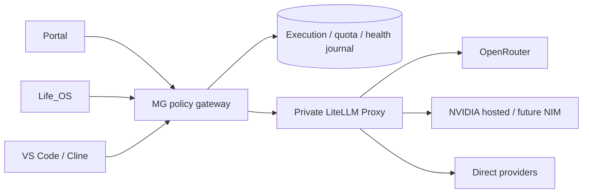

# MaghsoudGroup AI Infrastructure

Shared internal System of Intelligence for MaghsoudGroup_Portal, Life_OS, VS Code/Cline,
and future company applications. Applications retain user experience, permissions and
business execution. This service owns AI policy and model execution.

**Paid inference is OFF. No provider is enabled initially. No GPU required.**
ChatGPT/Codex subscriptions do not fund this gateway's inference.



## Local startup: Windows + Docker Desktop

From this repository, with Python 3.12 and Docker Desktop running:

```powershell
py -3.12 -m venv .venv
.\.venv\Scripts\python -m pip install --require-hashes -r requirements.lock
.\.venv\Scripts\python -m pip install --no-deps -e .
.\.venv\Scripts\python scripts/init_local.py
.\.venv\Scripts\python scripts/prepare.py
docker compose up --build -d
```

`init_local.py` refuses to overwrite `.env`. It creates independent random MG client
and proxy tokens without printing values. No paid credentials or registration required.
On Linux use `python3.12` and `.venv/bin/python`.

Gateway URL: `http://127.0.0.1:8090/v1`. Only `/health/live` is public, returning constant
liveness. Authenticated `/health/ready` reports `configured_no_eligible_provider` until a
reviewed, credentialed, qualified model is available. Container health does not mean
inference is configured. Give each consumer only its own MG token and MG URL. LiteLLM
has no published host port. Never distribute proxy/provider keys to consumers.

## Clients

| Client | Logical model names | Default |
|---|---|---|
| portal | portal-normal, portal-deep | Free-only |
| life-os | life-study, life-document | Free-only |
| developer | dev-light, dev-code, dev-reasoning, dev-vision, dev-strong | Free-first, currently free-only |

`POST /v1/chat/completions` and `GET /v1/models` are the stable boundary. Text, function
tools, JSON output and inline images require reviewed capabilities. SSE is buffered.
Responses API, file upload and remote image retrieval are not implemented.

## Configuration and operation

- [Architecture](docs/ARCHITECTURE.md), [decision record](docs/DECISIONS/0001-gateway-core.md)
- [Provider activation](docs/PROVIDERS.md), [routing and registry](docs/ROUTING.md),
  [live FREE benchmark](docs/LIVE_BENCHMARK.md)
- [Portal, Life_OS and Cline integration](docs/INTEGRATION.md)
- [Security](docs/SECURITY.md), [operations](docs/OPERATIONS.md)
- [Current state and validation](docs/CURRENT_STATE.md), [dependencies](docs/DEPENDENCIES.md)

Edit approved JSON registry/policies/routes, run `scripts/prepare.py`, and recreate with
`docker compose up --build -d`. Discovery (`python -m mg_ai.discovery`) refreshes official
catalog metadata separately; it never enables candidates. Provider Capacity
(`python -m mg_ai.capacity`) reads sanitized control-plane evidence. Credentials alone never
enable inference. The live benchmark is explicit, synthetic, pinned-model and free-only;
route recommendations still require human and owner approval.

## Repository map

| Path | Responsibility |
|---|---|
| mg_ai/ | Typed API, registry, routing, adapters, state, scope/evaluation tools |
| gateway/ | MG Docker build |
| providers/ | Provider execution contract |
| routing/, model-registry/, policies/ | Operator JSON and generated JSON Schema |
| observability/ | Metadata and retention contract |
| evals/ | Synthetic fixtures, rubric and promotion workflow |
| scope-guard/ | Reusable task policy example |
| scripts/ | Initialization, configuration, validation, health and recovery |
| deploy/ | Future Server 3 Compose overlay |
| tests/ | Deterministic API, policy, adapter, state and tooling tests |
| docs/ | Architecture, contracts, operations and decisions |

## Validation

```powershell
.\.venv\Scripts\python -m pip install -e '.[dev]'
.\.venv\Scripts\python scripts/validate.py
```

Validation covers config, tests, lint, strict typing, package build and secret checks.
Docker build/health/contract checks are separate, recorded in CURRENT_STATE. No test calls
a live/paid provider. During development, test only the changed vertical slice.

Server 3 uses these containers behind a VPN/private TLS reverse proxy. Keep loopback binding
and private LiteLLM. Back up config, encrypted secrets and SQLite. Single-host operation is
intentional; replicas require a shared transactional journal. Deployment remains a future
owner-approved action. Portal and Life_OS source repositories are outside this change scope.
