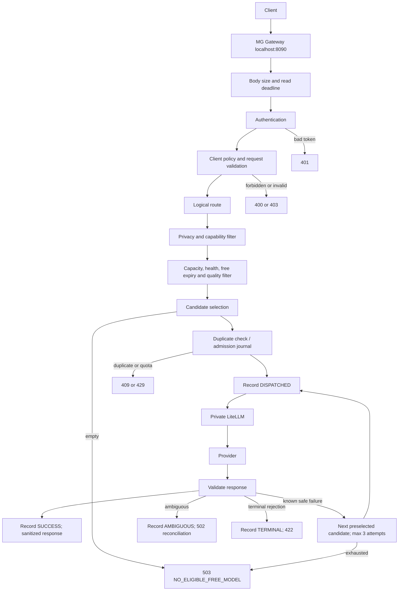

# Owner system map

Pre-server update: the optional private DEEP adapter is now implemented with disabled defaults;
the old FREE portal-deep alias is removed. All FREE models are currently disabled after the
single PUBLIC smoke hit ambiguous 429. Developer/Portal retain INTERNAL. For current status
and topology see [finalization](PRE_SERVER_FINALIZATION.md) and [DEEP backend](DEEP_BACKEND.md).
Earlier statements below reserving OmniRoute describe the previous handover.

Code-derived handover, 2026-09-10. Start here, then use the [runbook](OPERATIONS_RUNBOOK.md)
for commands, [code map](OWNER_CODE_MAP.md) for implementation, and
[approval points](OWNER_APPROVAL_POINTS.md) for decisions. This pack describes current code,
including limitations; it does not authorize enabling a model.

MG AI Infrastructure is the company's controlled entry point for AI requests. Clients use MG
tokens and logical routes instead of provider keys and model names. MG decides whether a
request is allowed, which qualified free model may receive it, and whether failure permits
trying another candidate. Models and providers can be replaced behind that entry point.

| Component | Actual responsibility |
|---|---|
| Gateway, `mg_ai/gateway.py` | Authenticate; validate; apply client, route and privacy constraints; select; journal; dispatch; return normalized JSON or buffered SSE |
| Client policy, `policies/clients.json` | Separate portal/life-os/developer tokens, routes, capabilities, privacy classes and request budgets; paid false |
| Logical routes, `routing/routes.json` | Intent tier, required capabilities, task score threshold, optional Champion tie preference |
| Model Registry, `model-registry/models.json` | Owner-entered approval, free evidence/expiry, capability and quality claims, privacy eligibility, credentials' environment-variable names and enable flags |
| LiteLLM, `compose.yaml` / `mg_ai/proxy_config.py` | Private translation from registered alias to provider API; holds provider credentials; outbound inference; retries and fallbacks disabled |
| Provider Capacity, `mg_ai/capacity.py` | Explicit current-key metadata refresh and expiring SQLite observations; fresh matching evidence may exclude a candidate; does not discover capacity during chat |
| Model Intelligence, `mg_ai/model_intelligence.py` | Compare saved fixed-dataset results and emit provisional recommendations; no runtime mutation or promotion |
| Discovery, `mg_ai/discovery.py` | Public catalog refresh, zero-price filtering and disabled proposals; no quality certification |
| Live Benchmark Runner, `mg_ai/live_benchmark.py` | Fixed synthetic probes through a separate LiteLLM; journal, score and stop on execution failure; bypasses Gateway policy/selection, never promotes |
| Execution Journal, `mg_ai/state.py` | SQLite admission counters, request/key hashes, execution state, model health and capacity; no answer replay/cache |
| Scope Guard, `mg_ai/scope_guard.py` | Standalone local changed-file policy inspection; not automatically invoked by Gateway/Cline |

## Request and failure path

For exact ordering: duplicate checking precedes selection; transactional admission follows it.
Filters and sorting are all in `mg_ai.routing.select`. Candidates are selected once before
dispatch, not refreshed between attempts. See [exact flows](REQUEST_FLOWS.md).

**Fallback** means trying the next eligible candidate after a classified safe failure, within
the same admitted request. There is no configured Fallback slot. **Reconciliation** means
execution may already have happened: preserve the journal and investigate rather than
resubmitting. The system does not reconcile automatically or retrieve the old answer.

## Verified state and qualification limits

| State | Evidence / owner meaning |
|---|---|
| VERIFIED now, local read-only | Gateway `/health/live` HTTP 200; Gateway and LiteLLM Docker health healthy; 12 registry entries, enabled 0, Champion unset |
| VERIFIED in saved 2026-09-10 certification | OpenRouter FREE authentication; North Mini Code pinned smoke PASS; Nex five limited benchmark probes and two developer contract calls PASS |
| CANDIDATE | Nex N2.5 Pro is a provisional recommendation, not a final/active Champion |
| BLOCKED / incomplete | Super stopped on ambiguous tool execution; Gemma 26B/31B failed upstream configuration checks; no certified Fallback |
| NOT YET CERTIFIED | General Persian/code quality, confidential use, production readiness and interactive Cline E2E |

Prior certification reported paid requests 0, automatic promotion OFF. This handover consumed
no provider quota and did not repeat authentication or inference. Historical account capacity
is not a fresh quota promise. [Certification report](LIVE_CERTIFICATION_20260910.md).

## Important corrections to older descriptions

- Champion does not override higher measured quality: score sorts first, Champion preference second.
- Following safety hardening, 429 is safe only with matching unexpired provider/model/adapter
  review; unreviewed 429 is ambiguous with no fallback. No real provider has an approved review.
- Host capacity refresh writes host SQLite; it does not update the running Docker volume unless run inside Gateway.
- Registry/configuration is baked into the Gateway image. Host JSON edits require render, rebuild and recreate.
- Benchmark execution bypasses client budgets, privacy/capability selection and capacity checks
  in Gateway, but verifies an approved dataset hash and honors the shared persistent provider stop.
- Privacy approval is recorded metadata; code does not verify provider contracts or perform DLP.
  Client default privacy now also acts as a minimum; requesting a lower level is rejected.
- `cost_estimate_usd=0` is policy metadata, not a reconciled provider billing ledger.
- Historical queued Super was only added to an ignored certification registry, not the main 12 entries.
- Old missing-key/no-inference statements in the historical section of CURRENT_STATE are superseded
  by the dated certification. Startup health alone never proves provider availability.
